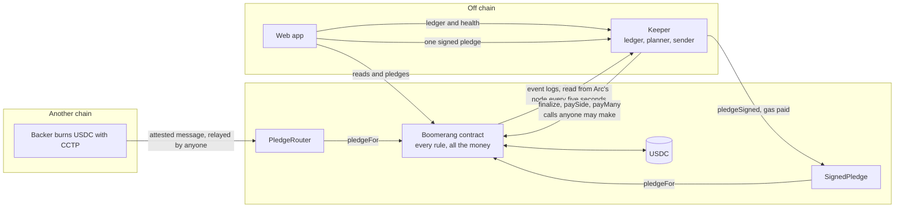

# Architecture

**Status:** describes the code in this repository. It has been deployed on Arc Testnet since 2026-11-17; the addresses are in `packages/kit/addresses.json` and the README, and no live measurement appears here.
**Last reconciled:** 2026-11-19.
**Known gaps:** the keeper has read Arc's node on Azure since 2026-11-18 20:53 UTC and has settled the six campaigns that came due on Arc since (campaigns 6 to 11, 2026-11-19), all of them small desk campaigns; the router has only run against a stand-in for Circle's contracts, written from Circle's published source; the one-signature pledges on Arc were signed by scripts, and five by the page's practice wallet, so how common wallets show its typed data is not checked; no pledge from another chain has run on Arc.

## The parts

| Part | Where | What it is trusted with |
|---|---|---|
| `Boomerang.sol` | `contracts/contracts/` | Everything. It holds the money and enforces every rule. No owner, no upgrade, no pause, no sweep. |
| `PledgeRouter.sol` | `contracts/contracts/` | One transaction's worth of one backer's USDC, between Circle's mint and the pledge. It keeps nothing. |
| `SignedPledge.sol` | `contracts/contracts/` | One transaction's worth of one backer's USDC, between the backer's signature and the pledge. No owner; it keeps nothing and moves money only as the signature says. |
| Keeper | `services/keeper/` | Nothing. It holds no right in the contract; it pays gas for calls anyone may make. |
| Kit | `packages/kit/` | Nothing. Shared arithmetic, event decoding and the event-built ledger, tested equal to the contract. |

## The contract

One contract holds every campaign. The rules are in [ECONOMICS.md](ECONOMICS.md); what matters for the architecture:

- **Custody.** `balance >= totalOwed` at all times. Money in is counted as owed only after it is seen to arrive; a payout is taken off the amount owed before tokens move and put back if the token refuses.
- **No one is needed.** After a deadline, `finalize`, `pay`, `payMany` and `paySide` can be called by any account, and each pays only the address the rules name. A second call does nothing.
- **Every event is numbered.** Each event carries `seq`, counting from 1 with no gaps, so anything that reads the events can tell a repeat from a gap.
- **Views for the app.** `quoteIfMissed(id, amount)` answers, before a pledge is made, what that pledge would bring back if the campaign then missed.

## A pledge from one signature

1. The page asks the contract what the pledge would take (`quoteIfMissed`), then asks the wallet for one EIP-712 signature: Circle's `ReceiveWithAuthorization` on USDC, from the backer, to `SignedPledge`, for that amount, valid from a minute ago until three minutes from now or the campaign's close, whichever is sooner, with nonce `keccak256(abi.encode(id, amount, salt))` and a random salt.
2. The page posts it to the keeper's `POST /relay`. Before sending anything the keeper reads the body strictly (2 KiB at most), recovers the signer off-chain and requires it to be the backer, allows one request per backer at a time, five sends per backer per hour, sixty requests a minute from everyone together, twenty being checked at once and ten waiting in the send line, requires a window that has begun, has at least 30 seconds left and ends at most 15 minutes from now, keeps its own USDC above a 3 USDC floor, and tries the call with `eth_call`, first before the request takes a place in the send line the keeper's settlement calls also use, then again in it. A request that waited more than ten seconds in that line is turned away unsent. Refused requests spend the per-minute budget too, so one sender with empty keys can keep it used up; real backers then get "busy" and pledge in two steps. A limit per sending address belongs to the proxy in front of the keeper.
3. `pledgeSigned` takes the USDC with `receiveWithAuthorization` (only the payee may submit it, so only this helper can use the signature), approves Boomerang for exactly that, calls `pledgeFor(id, backer, amount)` so the backer owns the pledge and every payout, resets the approval and sends back whatever the campaign did not take. A pledge the campaign refuses is not caught: the whole call reverts, the USDC never leaves the backer and the signature stays unused.
4. If the keeper refuses before sending, the page says why and the next press of Pledge sends the two-step pledge (allow, then pledge). If the keeper gives no answer in 20 seconds, answers that a send failed, or says another of the backer's signatures is on its way, a transaction may still land, so the signature is remembered in the browser's storage (this page's memory where storage is blocked) and no pledge to that campaign is sent from that browser, signed or two-step, until its window has passed by the chain's clock; USDC is then asked, at that block, whether it was used. Two tabs pledging to the same campaign at the same moment, each confirmed in the wallet, can still both go through.

## A pledge from another chain

1. The backer burns USDC on the source chain with CCTP V2. The burn names the router as the mint's recipient and as the only allowed caller, and carries `(campaign id, backer address)` as hook data.
2. Circle attests the message. Anyone may then call `relay(message, attestation)` on the router.
3. The router refuses the message, before receiving it, unless its header is addressed to Circle's token messenger, its mint goes to the router, and its hook data is exactly a campaign id and an address.
4. It hands the message to Circle's transmitter, measures what was minted from its own balance, and calls `pledgeFor` with at least 400,000 gas in hand.
5. Whatever the campaign did not take (all of it, if the pledge was refused) goes to the backer's address on Arc in the same transaction.

Refunds and bonuses are paid on Arc, to the backer's address.

The check in step 3 exists because of an attack the audit found: without it, a message of the thief's own could make Circle's transmitter run the thief's contract in the middle of a relay and receive another backer's waiting burn. The test stand-in was rebuilt to behave like Circle's so that a test shows the theft failing ([ATTACKS.md](ATTACKS.md), row R0).

## The clock: the keeper's own reading of the node

The contract does nothing by itself at a deadline. The keeper is what makes the calls happen on time, and it has one source: every five seconds it asks Arc's node for the newest block and for Boomerang's logs since the last block it heard. The newest block's time is its clock. Nothing is pushed to it and it needs no account with anyone. The detail is under "Reads the node itself" below.

## The keeper

A small Node service that reads the node, with read-only routes for the app and two routes the page posts to (the relay and the demo desk).

- **Bounds what a caller can make it hold.** The only bodies it reads are those of `POST /relay` (2 KiB at most) and `POST /demo/usdc` (1 KiB at most). A body is read as plain JSON and has ten seconds to arrive; all bodies being read at one moment share a 256 KiB budget; a request's headers must arrive within fifteen seconds and all of it within thirty; a body sent to a route that reads none closes the connection with the answer; and at most 256 connections are open at once. These limits do not stop a flood: a machine that keeps opening connections can keep the page's requests out for as long as it keeps going. Nothing is lost when that happens. The keeper's reading of the node and its settlement calls go out, not in, and every payout can still be called by anyone. Keeping floods out is the job of the host's proxy in front of the keeper, not of the keeper. The key is given in the environment, so anyone who can read the process's environment on its host can read it; it is deleted from the running process's own copy before anything else happens, never logged and never written.
- **Rebuilds a ledger from events alone.** Events are applied strictly in `seq` order. A repeat is dropped and counted; anything after a missing number is held back and the gap is reported. An event that does not fit the ledger is set aside and counted, never fatal. Such an event can only come from the node the keeper reads, so only a node that lied could put it there; what that can and cannot do is in the bullets below. This is the second ledger the Proof page shows beside the contract's own figures.
- **Plans from the ledger.** On every read the planner (`services/keeper/src/plan.ts`) takes the ledger and the keeper's clock and names the calls that would move a campaign forward: `finalize` when one is due, each `paySide` that has something to pay, `payMany` in batches of 40. The plan comes from the ledger alone, so a deadline is settled at the first read after it. The keeper's clock is the latest block time a read has carried. It only moves forward and is used only to decide what is due. The machine's own date is not used for any decision.
- **Asks the contract before it spends.** The ledger can be wrong: it is built from what a node said, and a node could lie. So before any call is sent, the sender reads the contract, at one block (the node's newest, asked for afresh each time, never a block number the client remembered), and sends only what the contract says will change something: a `finalize` for a campaign that is open and due, a `paySide` with money to pay, a `payMany` naming only backers who are owed and at least one of whom can be paid. Reading costs no gas. What the contract says is finished for good (an outcome already set, a side with nothing to pay, a backer owed nothing) is remembered and not asked again, so a false event costs the keeper questions to the contract and no gas. A false time makes the keeper ask early; the contract answers "not due", and the keeper asks again after 20 seconds, then 40, up to 320, so the real settlement can be up to about five minutes late and is never stopped. This is the costliest thing a false reading can do: the keeper's clock stays ahead until its store is cleared, and for that long each open campaign costs one question every 320 seconds until it is really due. The same wait applies when the ledger has heard an outcome the contract does not show yet, which is what a node a block behind looks like (a public address can be served by more than one machine), and what a false "missed" looks like: nothing is sent and nothing is counted as refused. The keeper acts only when a read arrives, so a question put off like this is asked again at the first read after its wait, five seconds on at most.
- **Takes the contract's word for the outcome.** Each answer from the contract carries the outcome it shows, and the keeper plans from that in place of its ledger's. An outcome the contract has set is taken at once and kept, also when the ledger has heard a different one or none: the true `Finalized` event may never arrive, because a false event can hold its number. Told the outcome, the keeper plans again in the same read and pays. "Still open" overrules a ledger that says "settled" only after the contract has said it for a minute, counted from the contract's first "open" after the ledger first heard an outcome for the campaign (for that long it may be a node behind; repeating the false event does not restart the minute); the campaign then goes back to being open and is settled when it is really due. In case the node was behind for longer than a minute, the ledger's outcome is tried again each time the time since that first "open" has doubled (two minutes, four, eight, and so on), so a campaign that funded early is paid soon after the node catches up, and a false "settled" costs a few questions at each of those times. Both disagreements are named in `/health`. A call of the keeper's own that goes through shows the outcome is set too, and a remembered "still open" is dropped.
- **Reads the node itself.** The keeper acts only when it is handed a reading of the chain. The follower (`services/keeper/src/follow.ts`) asks the node every five seconds for the newest block and for Boomerang's logs since the last block the keeper heard, and hands them to the ledger, planner and sender as one delivery. That is two small requests every five seconds (Arc's logs carry their block's time; for a node whose logs do not, the block is asked for, once). It reads in small steps and keeps its place, because a public node refuses a caller that asks too much at once: one read makes at most two log requests of at most 10,000 blocks each (the most Arc's node takes in one call), so a keeper that is a long way behind catches up 20,000 blocks every five seconds, and a part that does not reach the newest block carries only the time of its own newest log, so the keeper's clock never runs ahead of what it has been told. If an event number has been missing from the ledger for a minute, the follower reads again from the block the contract was created in, once for that hole, one log request every five seconds beside the reading of new blocks; events the ledger already has are counted as repeats. A request for a hole that fails does not hold up new blocks, and the hole is taken up again from where it was after two minutes, then four, doubling to about an hour. A node's logs are believed, so a node that lied could feed the ledger false events, with one limit: the sender asks the contract before it spends. `/health` carries, under `node`, the follower's count of reads, its last block and its faults (a node's error text is never kept, since an RPC address can carry a key). Nothing can push events to the keeper: it has no route that takes any. `FOLLOW_NODE=off` turns the follower off, which leaves a keeper that relays pledges and runs the desk but settles nothing. It starts from the block the kit records for the deployed contract; for any other contract on Arc the keeper will not start with the follower on unless `DEPLOY_BLOCK` says where that contract's events begin, because a read from block 0 of Arc would never end.
- **Takes the contract's word for each side, and the ledger's for the backers.** Whether the recipient, the match or the bonus pool still has money to pay is the contract's to say. Each of the three sides of a settled campaign is put to the contract until the contract calls it finished, whatever amounts and "paid" marks the ledger holds. On an honest ledger that is one question after each payment, and three questions for each settled campaign when the keeper starts again (what the contract called finished is kept in memory only). A campaign in the ledger that the contract does not have (a false `CampaignCreated`, or a node that is behind) is asked about again after 20 seconds, then 40, doubling to about a day; it costs no gas and is listed in `/health` as `absent`. With events missing from the ledger, a campaign that looks to have a pot missing at its opening second is still put to the contract as void; if the pot was funded in the gap, the contract says "not due" and nothing is sent, and after four such answers, over a little more than two minutes, the keeper drops the guess until the closing second. What this does not reach: which backers exist, and which of them are paid, the keeper knows only from its ledger. A node that lied can give it a false `Paid`, or put a false event on the number of a real `Pledged`, and the keeper then does not pay that backer. A false `PotFunded` can put off an early void until the closing second, when the contract decides for itself. The keeper does not detect either. The money stays in the contract, `pay` and `payMany` stay open to anyone, the page reads what a backer is owed from the contract and offers the refund call, and the Proof page shows the keeper's figures beside the contract's.
- **Repeats are rationed.** Waits are measured on a timer of the keeper's own machine that only runs forward. A call the node or the network dropped is offered again after 20 seconds. One the contract refused (a side payee the token will not pay) waits 10 minutes. A backer whose payout failed, or would fail, is offered again after 10 minutes, then 20, doubling to about eleven hours, or at once after they redirect; a node that lied could forge that failure and so delay one backer's automatic payout, which the backer or anyone else can still call by hand. As a second line behind the question to the contract, a call that went through and is still planned waits 20 seconds, then 40, doubling, and after eight sends is dropped and named in `/health` until the campaign moves or the keeper restarts.
- **One transaction at a time.** Everything the keeper's account sends waits in one line, so two transactions never race for a nonce.
- **Survives a restart.** Each event is written to an append-only file before it is applied. A restart replays the file; a line cut off by a crash is dropped, and its event is read again from the node (once its number shows as missing, the follower re-reads from the contract's first block). The clock and the block in `/health` come back from the newest stored event; its counters are since the last start. A restarted keeper has forgotten what the contract told it and what it had just been refused, so it asks again, once.
- **A relay for one-signature pledges, on when `SignedPledge` is known.** With a key and the helper's address, `POST /relay` submits backers' signatures through the same send line and pays their gas; its limits are under "A pledge from one signature". What it can lose is gas, bounded by those limits and its floor; it cannot move a backer's money anywhere the signature does not name.
- **A demo desk, off by default.** With a key and `DEMO_RECIPIENT` set, the keeper's account also hands a visitor 2 test USDC once per address and opens one small, fully funded demo campaign at a time. There are two kinds, with the same pots and target: one takes pledges for two minutes (it opens 45 seconds after it is asked for, since both pots must be locked before a campaign opens) and one for ten (it opens after a minute). The ten-minute one pays an early pledge more the earlier it comes; the two-minute one pays every pledge in its 72-second early window the same, because a bonus that shrank that fast fell a cent every few seconds and the page, which stops a pledge when the figure it showed has fallen, kept stopping pledges. The times are the desk's own constants, never the asker's. It gives test USDC only while it holds at least 5 and opens a campaign only while it holds at least 4.30, so about 3 USDC stays behind for gas and everything above that can be given away. Those limits are checked against the confirmed balance, so the desk does nothing while any transaction from its account is still unconfirmed. The keeper's own settlement calls are paid from the same account and are not held to any floor. A transfer is tried without sending, then made ready without sending (nonce, gas and fee); a fault up to there records nothing and the address may ask again. Once it has been handed to the node, the address counts as given unless the transfer is seen mined and reverted, even if the node's answer or the receipt never arrives, so an address can lose its turn to a network fault at that one step but cannot be paid twice. A campaign is written down before its creation is sent, so a restart at any moment does not open a second one beside it; one cut off before its pots were funded goes void by itself. The count of unconfirmed transactions is the node's own, so a node that could not see its waiting transactions would let the desk dip below its floor by what is in flight. The desk is a convenience for testnet and has no part in the rules.

If the keeper is off, nothing is lost: any person can make the same calls from a block explorer, and payouts are only later.

The keeper's settings are environment variables, read once at start (`services/keeper/src/settings.ts`); a wrong one stops it with the variable's name and never its value.

| Variable | Needed | What it is |
|---|---|---|
| `KEEPER_PRIVATE_KEY` | to send | the account that makes the settlement calls; without it the keeper only watches and rebuilds the ledger |
| `RPC_URL` | no | the node to send through (https); default Arc Testnet's public RPC |
| `BOOMERANG_ADDRESS`, `USDC_ADDRESS` | no | default: the addresses the deployment wrote to `packages/kit/addresses.json` |
| `PORT`, `KEEPER_DATA` | no | default 8787 and `./data` (the event file and the desk's notes) |
| `HOST` | to be reached from outside | the IP address the server listens on; default `127.0.0.1`, this machine only. A host that routes outside traffic straight to the process needs `0.0.0.0` |
| `SIGNED_PLEDGE_ADDRESS` | no | the one-signature helper; default: the address the deployment wrote to `packages/kit/addresses.json`; with none, and no key, there is no relay |
| `DEMO_RECIPIENT` | for the desk | the recipient of the desk's demo campaigns; setting it, with a key, turns the desk on |
| `CHAIN_ID` | no | only for the local demo loop: any id other than Arc Testnet's requires `RPC_URL` on this machine and both addresses given |

## The kit

`packages/kit` is what the keeper, the scripts and the app share:

- the contract's arithmetic in TypeScript (weights, the bonus, shares, the quote), tested against the contract's own views on 200 random states;
- event decoding;
- the ledger, tested to equal the contract's state field by field after random sequences of actions;
- the ABI, the chain and the deployed addresses.

## The web app

A static page. It reads campaigns and quotes from the contract, sends pledges from the visitor's wallet, and reads the keeper's ledger and health for the live feed and the Proof page. It holds no key and no server-side state.

## What runs where, and who can stop it

| If this stops | What still works | What waits |
|---|---|---|
| The web app's host | The contract; pledges and payouts from any wallet or explorer | The page |
| The keeper | Pledges; payouts called by hand | Automatic `finalize` and payouts |
| Circle's attestation service | Pledges made on Arc | Pledges from other chains |
| Arc Testnet | Nothing | Everything |

No one, including the deployer, can change the contract, move its money outside the rules, or stop a payout.
